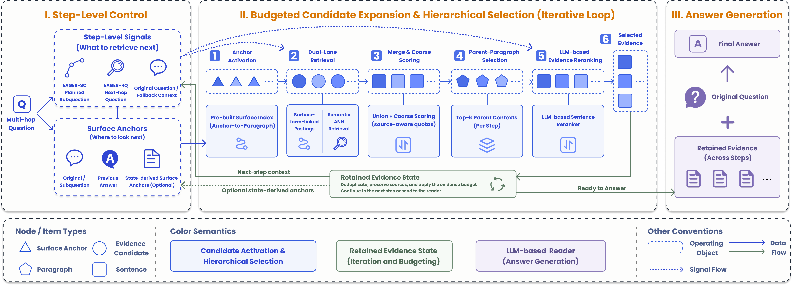
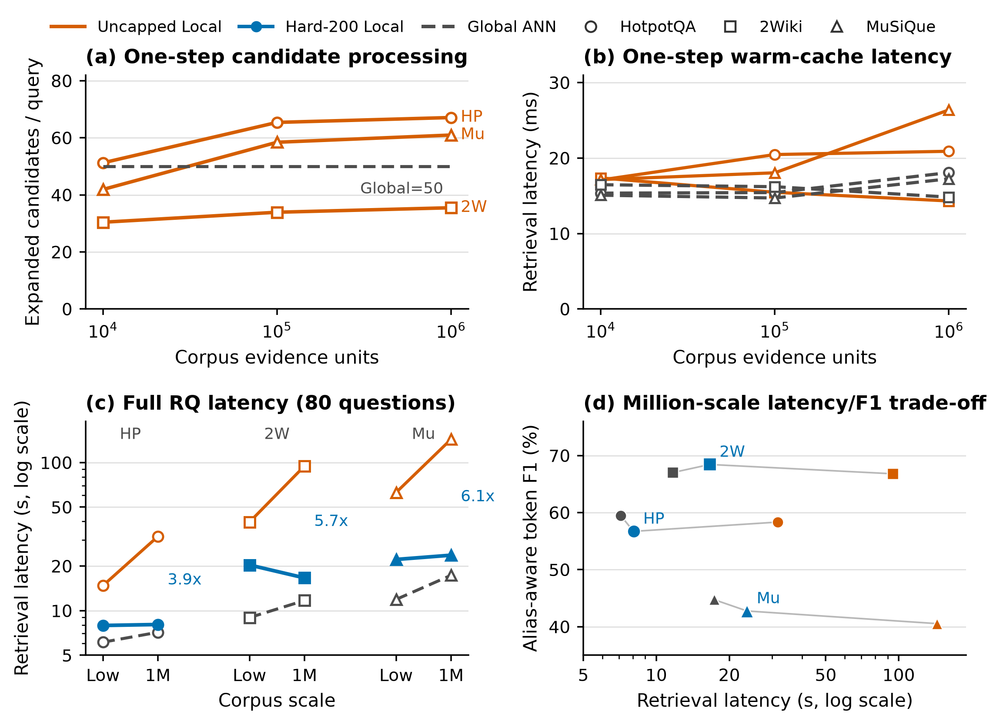

# EAGER: Anchor-Driven Evidence Construction for Multi-Hop RAG

[](https://wsdm-conference.org/2027/)



EAGER is an anchor-driven evidence-construction framework for multi-hop
retrieval-augmented generation. It separates step-level control from evidence
construction and combines surface-linked activation, semantic retrieval,
hierarchical selection, and persistent evidence state for retrieval-question
(RQ) and subquestion-chain (SC) controllers.

The paper, **“EAGER: Anchor-Driven Evidence Construction for Multi-Hop RAG,”**
was accepted as a **Findings paper at WSDM 2027** (Paper ID 1877). The
conference will be held in Hong Kong on February 15--19, 2027, with poster
presentations for Findings papers.

## Quick start

Python 3.10--3.12 is supported.

```bash
python -m venv .venv
python -m pip install --upgrade pip
python -m pip install -e ".[core,dev]"
python -m spacy download en_core_web_sm
```

Run the offline verifier and fixture-backed tests:

```bash
python analysis/verify.py
python -m pytest -q
```

A small retrieval smoke run is also available without a hosted model:

```bash
python -m eager.cli data index \
  --corpus tests/fixtures/indexing/corpus.jsonl \
  --output tmp/quickstart-index \
  --dimensions 32

python -m eager.cli retrieve \
  --dataset 2wiki \
  --question "Where is the company founded by Mira Sol headquartered?" \
  --corpus tests/fixtures/indexing/corpus.jsonl \
  --index tmp/quickstart-index \
  --mode retrieval-question
```

## Reproduce the main runs

The public release keeps the six main 1,000-question wrappers:

| Dataset | RQ | SC |
| --- | --- | --- |
| HotpotQA | `experiments_sandbox/20260728_027_hotpotqa_rq_v1_full1000/run.py` | `experiments_sandbox/20260728_028_hotpotqa_sc_v1_full1000/run.py` |
| 2WikiMultiHopQA | `experiments_sandbox/20260728_029_2wiki_rq_v1_full1000/run.py` | `experiments_sandbox/20260728_030_2wiki_sc_v1_full1000/run.py` |
| MuSiQue | `experiments_sandbox/20260728_031_musique_rq_v1_full1000/run.py` | `experiments_sandbox/20260728_032_musique_sc_v1_full1000/run.py` |

Download the registered datasets and build the MiniLM and surface indexes before
running the wrappers. Hosted generation reads `OPENAI_API_KEY` and an
OpenAI-compatible endpoint from local configuration; credentials are never
stored in the repository.

## Results

The compact tables used by the paper are in:

- [`results/p9_conacc_alias_f1_v1/`](results/p9_conacc_alias_f1_v1/)
- [`results/eager_v1_main1000_20260728/`](results/eager_v1_main1000_20260728/)
- [`results/million_matched_rq_20260819/`](results/million_matched_rq_20260819/)

The main quality metrics are ConAcc and alias-aware token F1. Component,
structure, and million-unit scaling analyses are included as compact CSV/JSON
products; raw hosted-model traces, model weights, and benchmark downloads are
not included.



## Project structure

- `src/eager/` — retrieval kernel, controllers, state update, evaluation, and runtime
- `configs/` — model and retrieval configuration examples
- `prompts/` — controller, reader, and evaluation prompts
- `results/` — compact paper tables and audits
- `tests/` — offline unit and contract tests
- `analysis/verify.py` — release inventory and result verifier

## Citation

Please cite the WSDM 2027 Findings paper once the final bibliographic record is
available. The repository will be updated with the final citation metadata when
it is released.
